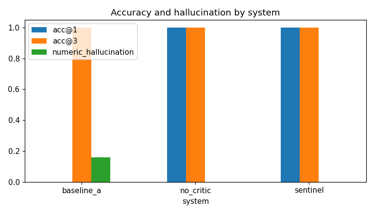

# Axiom eval report

6 runs (2 scenarios, 1 seed(s), systems: baseline_a, no_critic, axiom).

## Summary

| system     |   runs |   errors |   det_precision |   det_recall | false_positive_rate   |   acc@1 |   acc@3 |   overlap@3 | both@3(two-cause)   |   contribution_mae_pp |   evidence_support |   numeric_hallucination | data_issue_recall   |   data_issue_false_flag |   latency_s_median |   tokens_per_run |
|:-----------|-------:|---------:|----------------:|-------------:|:----------------------|--------:|--------:|------------:|:--------------------|----------------------:|-------------------:|------------------------:|:--------------------|------------------------:|-------------------:|-----------------:|
| baseline_a |      2 |        1 |               1 |            1 | n/a                   |       0 |       1 |           1 | n/a                 |                100    |               0.33 |                    0.16 | n/a                 |                       0 |             828.1  |          35974   |
| no_critic  |      2 |        0 |               1 |            1 | 0.00                  |       1 |       1 |           1 | n/a                 |                  0.79 |               1    |                    0    | n/a                 |                       0 |             820.3  |          33288   |
| axiom   |      2 |        0 |               1 |            1 | 0.00                  |       1 |       1 |           1 | n/a                 |                  0.79 |               1    |                    0    | n/a                 |                       0 |            1166.85 |          78361.5 |

## acc@1 per business scenario (mean over seeds)

| scenario   |   baseline_a |   no_critic |   axiom |
|:-----------|-------------:|------------:|-----------:|
| S11        |            0 |           1 |          1 |

