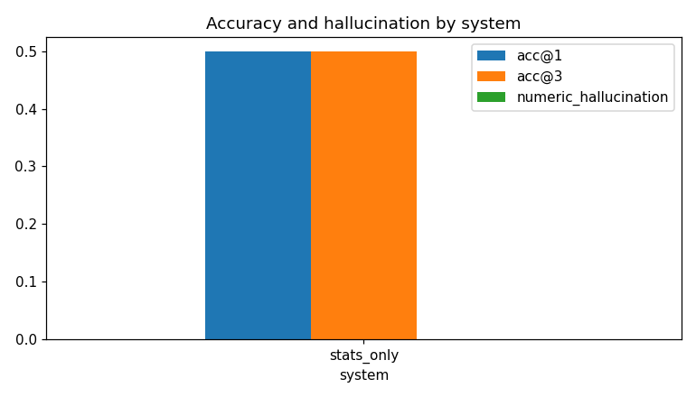

# Sentinel eval report

84 runs (28 scenarios, 3 seed(s), systems: stats_only).

## Summary

| system     |   runs |   errors |   det_precision |   det_recall |   false_positive_rate |   acc@1 |   acc@3 |   overlap@3 |   both@3(two-cause) |   contribution_mae_pp | evidence_support   | numeric_hallucination   |   data_issue_recall |   data_issue_false_flag |   latency_s_median |   tokens_per_run |
|:-----------|-------:|---------:|----------------:|-------------:|----------------------:|--------:|--------:|------------:|--------------------:|----------------------:|:-------------------|:------------------------|--------------------:|------------------------:|-------------------:|-----------------:|
| stats_only |     84 |        0 |            0.85 |         0.83 |                  0.08 |     0.5 |     0.5 |        0.75 |                   0 |                 37.91 | n/a                | n/a                     |                   1 |                       0 |                0.9 |                0 |

## acc@1 per business scenario (mean over seeds)

| scenario   |   stats_only |
|:-----------|-------------:|
| S01        |     0        |
| S02        |     0        |
| S03        |     1        |
| S04        |     1        |
| S05        |     0        |
| S06        |     0        |
| S07        |     1        |
| S08        |     0        |
| S09        |     0        |
| S10        |     0.333333 |
| S11        |     1        |
| S12        |     0.666667 |
| S21        |     1        |
| S22        |     1        |
| S23        |     0        |
| S24        |     1        |

